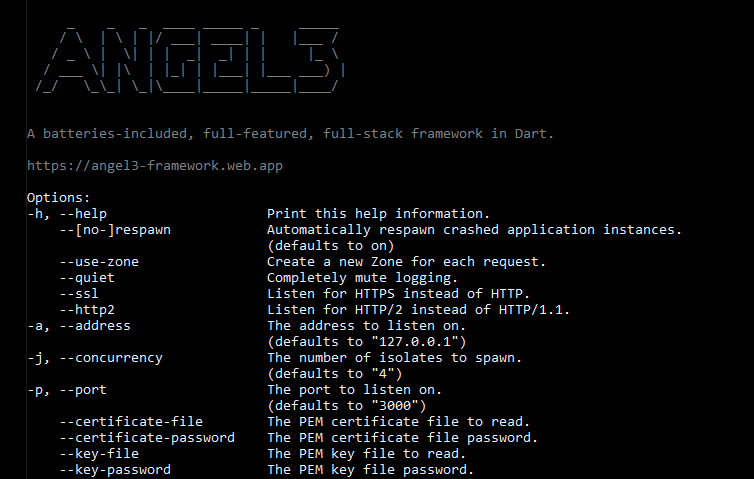

# Angel3 Production Runner


[](https://dart.dev/null-safety)
[](https://discord.gg/3X6bxTUdCM)
[](https://github.com/dart-backend/angel/tree/master/packages/production/LICENSE)

Helpers for concurrency, message-passing, rotating loggers, and other production functionality in Angel3 framework.



This will become the de-facto way to run Angel3 applications in deployed environments, as it takes care of inter-isolate communication, respawning dead processes, and other housekeeping for you automatically. Most users will want to use the `Runner` class.

## `Runner`

`Runner` is a utility, powered by `package:args`, that is intended to be the entry point of your application.

Instantiate it as follows, and your file will become a command-line executable that spawns multiple instances of your application:

```dart
import 'dart:async';
import 'dart:isolate';
import 'package:angel3_framework/angel3_framework.dart';
import 'package:angel3_production/angel3_production.dart';

void main(List<String> args) => Runner('example', configureServer).run(args);

Future configureServer(Angel app) async {
  app.get('/', (req, res) => 'Hello, production world!');

  app.get('/crash', (req, res) {
    // We'll crash this instance deliberately, but the Runner will auto-respawn for us.
    Timer(const Duration(seconds: 3), Isolate.current.kill);
    return 'Crashing in 3s...';
  });
}
```

`Runner` will automatically re-spawn crashed instances, unless `--no-respawn` is passed. This can prevent your server from entirely going down at the first error, and adds a layer of fault tolerance to your infrastructure. An instance that keeps crashing is respawned after a delay that doubles from 1 s to 30 s, and is reset once it has run for a minute.

An instance that fails to *start* the first time (a port in use, a bad certificate, an error in `configureServer`) is not respawned: `run` ends with exit code 70, after closing the other instances, so that a supervisor such as `systemd` or Docker sees the failure. Once it has started, a failure to start again (say, a database that is briefly down) is respawned like a crash.

`SIGINT` (Ctrl+C) and `SIGTERM` (`docker stop`, `systemctl stop`; not on Windows) close every instance gracefully: it stops accepting requests, lets those in progress finish (for up to half of `shutdownTimeout`), and runs its shutdown hooks, all within `shutdownTimeout` (default 10 s), after which it is killed. A second signal exits at once. `Runner.stop()` does the same from code.

When combined with `systemd`, deploying Angel3 applications on Linux can be very simple.

## Message Passing

The `Runner` class uses [`belatuk_pub_sub`](<https://pub.dev/packages/belatuk_pub_sub>) to coordinate
message passing between isolates. When one isolate sends a message, all other isolates will receive the same message, except for the isolate that sent it. It is injected into your application's `Container` as `pub_sub.Client`, so you can use it as follows:

```dart
// Use the injected `pub_sub.Client` to send messages.
var client = app.container.make<Client>();

// We can listen for an event to perform some behavior.
//
// Here, we use message passing to synchronize some common state.
var onGreetingChanged = await client.subscribe('user_upgraded');
onGreetingChanged
    .cast<User>()
    .listen((user) {
      // Do something...
    });
```

## Customising Response Header

Additional parameters can be passed to the `Runner` class to:

1. Remove headers from HTTP response.
2. Add headers to HTTP response.

For example, the following code snippet removes `X-FRAME-OPTIONS` and adds `X-XSRF-TOKEN` to the response header.

```dart

void main(List<String> args) {
  // Remove 'X-FRAME-OPTIONS'
  var removeHeader = {'X-FRAME-OPTIONS': 'SAMEORIGIN'};

  // Add 'X-XSRF-TOKEN'
  var customHeader = {
    'X-XSRF-TOKEN':
        'a591a6d40bf420404a011733cfb7b190d62c65bf0bcda32b57b277d9ad9f146e'
  };

  Runner('example', configureServer,
          removeResponseHeaders: removeHeader, responseHeaders: customHeader)
      .run(args);
}

```

The added headers are defaults: a header that a handler sets replaces one of the same name. `removeResponseHeaders` removes the given values from those defaults (including the ones `dart:io` adds, such as `X-FRAME-OPTIONS: SAMEORIGIN`), not a header a handler sets. Both apply the same way with `--http2`. A list value is sent as one header of its values, except `Set-Cookie`, which is sent once per value. A list in `removeResponseHeaders` removes each of its values, a value matches exactly, or ignoring case if nothing matches exactly, such as `sameorigin` for the `SAMEORIGIN` of `dart:io`, and a `null` value removes a header whatever its values, e.g. `{'X-XSS-PROTECTION': null}`.

## Run-time Metadata

At run-time, you may want to know information about the currently-running instance, for example, which number instance. For this, the `InstanceInfo` class is injected into each instance:

```dart
var instanceInfo = app.container.make<InstanceInfo>();
print('This is instance #${instanceInfo.id}');
```

## Command-line Options

The `Runner` class supplies options like the following:

```bash
appuser$ dart example/main.dart --help
     _    _   _  ____ _____ _     _____ 
    / \  | \ | |/ ___| ____| |   |___ / 
   / _ \ |  \| | |  _|  _| | |     |_ \ 
  / ___ \| |\  | |_| | |___| |___ ___) |
 /_/   \_\_| \_|\____|_____|_____|____/                                                                                 

A batteries-included, full-featured, full-stack framework in Dart.

https://angel3-framework.web.app

Options:
-h, --help                    Print this help information.
    --[no-]respawn            Automatically respawn crashed application instances.
                              (defaults to on)

    --use-zone                Create a new Zone for each request.
    --quiet                   Completely mute logging.
    --ssl                     Listen for HTTPS instead of HTTP.
    --http2                   Listen for HTTP/2 instead of HTTP/1.1.
-a, --address                 The address to listen on.
                              (defaults to "127.0.0.1")

-j, --concurrency             The number of isolates to spawn.
                              (defaults to "4")

-p, --port                    The port to listen on.
                              (defaults to "3000")

    --certificate-file        The PEM certificate file to read.
    --certificate-password    The PEM certificate file password.
    --key-file                The PEM key file to read.
    --key-password            The PEM key file password.
```

Command-line arguments are visible to other users of the machine (`ps`), and end up in shell history, so give the passwords in the `ANGEL_CERTIFICATE_PASSWORD` and `ANGEL_KEY_PASSWORD` environment variables instead; an option given on the command line takes precedence.
